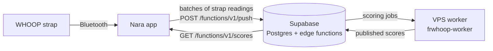

# Nara

Nara is an iPhone, Apple Watch and Mac app for the WHOOP strap. The app pairs with the strap over
Bluetooth, uploads the strap's history to the Nara backend, and shows the recovery, strain, sleep and
vitals that the backend computes.

## How it works

1. The app reads the strap over Bluetooth and keeps a local copy of everything in SQLite.
2. When cloud sync is on, it uploads those readings in batches to a Supabase edge function.
3. Each upload marks the affected days as needing a score. A worker on a VPS picks those days up,
   computes them with the same Swift scoring code the app ships, and publishes the results to Postgres.
4. The app pulls the published results back and shows them on its cards.

[docs/ARCHITECTURE.md](docs/ARCHITECTURE.md) walks through each step and the files involved.

## Repository layout

| Path | Contents |
| --- | --- |
| `Strand/` | The SwiftUI app shared by iOS and macOS: screens, Bluetooth, local store, cloud upload |
| `StrandiOS/`, `StrandiOSWidgets/`, `StrandiOSShared/` | iOS app target, widgets and code shared with them |
| `NOOPWatch/`, `NOOPWatchComplications/` | Apple Watch app and complications |
| `Packages/` | Swift packages: `StrandAnalytics` (scoring), `WhoopProtocol` (strap protocol), `WhoopStore` (SQLite store), `StrandDesign` (UI kit), `NoopPush` (upload wire format) and others |
| `Tools/CloudWorker/` | `frwhoop-worker`, the VPS service that computes scores |
| `deploy/` | VPS provisioning script, systemd unit and worker runbooks |
| `supabase/` | Edge functions and Postgres migrations for the hosted backend |
| `contracts/` | Pinned copies of the receiver contract the app and worker are tested against |
| `android/` | The Android app (not yet rebranded or simplified) |
| `Config/` | Build settings. The `*Secrets.xcconfig` files are gitignored; copy the `.example` files |

Some folder and target names still say NOOP or Strand. They are internal names kept so builds,
bundle identifiers and on-device data stay compatible.

## Guides

- [Build and install the iOS app](docs/IOS.md)
- [Run the backend: Supabase and the VPS worker](docs/BACKEND.md)
- [Provision and deploy the worker](deploy/README.md), and [operate it](deploy/OPERATIONS.md)

## Secrets

Nothing secret belongs in this repository. Keep these out of git:

- `Config/CloudPushSecrets.xcconfig` (upload endpoint, ingest token, anon key) and
  `Config/BundleIdSecrets.xcconfig`
- `.env` files and anything passed to `supabase secrets set`
- the worker's `/etc/frwhoop/worker.env` on the VPS (database URL, B2 keys, ingest secret)

The `.example` files in `Config/` and `deploy/worker.env.example` list the names without values.

## Licence

Nara is built on [NOOP](https://github.com/ryanbr/noop) and is distributed under its licence, the
PolyForm Noncommercial License 1.0.0. That licence does not allow commercial use. See
[LICENSE](LICENSE), [NOTICE](NOTICE), [ATTRIBUTION.md](ATTRIBUTION.md),
[DISCLAIMER.md](DISCLAIMER.md) and [TERMS.md](TERMS.md), which must stay with the code.

Nara is not affiliated with WHOOP, and it is not a medical device.
