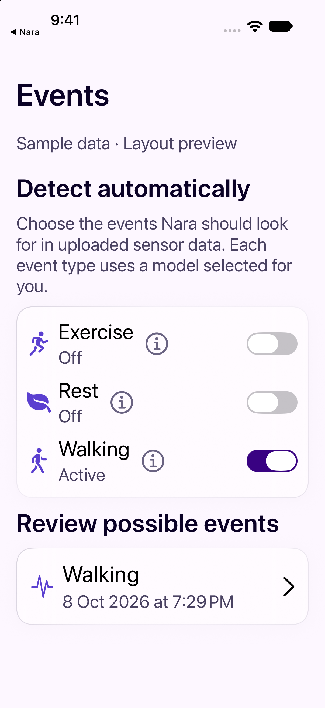
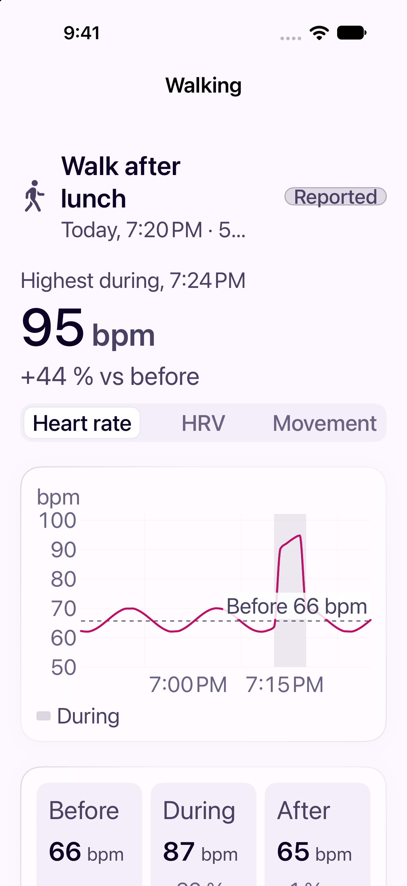

# Personal event detection: local validation

Run date: 2026-10-08. Base: `a1560f37edc2080a672b8281fc7f239d58c1c598` on `Rahulvijayan123/Nara-App/main`.

No cloud migration, function deployment, VPS service change, or physical-phone installation was performed for this replacement PR.

## Builds and tests

| Check | Observed result |
| --- | --- |
| macOS `Strand` build | Passed. |
| iOS `NOOPiOS` simulator build | Passed for the generic simulator and the iPhone 18 Pro simulator on iOS 27.0. |
| Event-focused Swift tests | 29 passed: 13 manual-event, 4 manual-sync, 4 personal-detection, and 8 event-presentation tests. |
| API and credential tests | 25 Deno tests passed with fixture services. Covers owner-derived writes, restricted commands, bounded physiology queries, and existing auth paths. |
| Worker and local PostgreSQL integration tests | 14 passed using the pinned base dependencies in a fresh Python environment. The isolated PostgreSQL 14 fixture was recreated and both migrations applied successfully. |
| Optional candidate smoke checks | 23 passed: each of the 18 heads with cardiac features, plus waveform, dynamics, catch24, MiniRocket and CNN encoders with ridge. Each fits, predicts, serializes and reloads on synthetic data. |
| Full macOS suite | 3,439 tests executed, 13 skipped, 11 assertion failures across the three cases below. The full suite is **not green**. |

The full-suite failures were:

- `ActivityCalibrationSessionTests.testBeginWithAnEmptyProtocolEndsCleanly`
- `ActivityCalibrationSessionTests.testStepsChainBackToBackAndEveryActivityEndsWithDone`
- `IntradayWordingAndCoachTests.testMinuteBucketsAreDescribedAsMinuteBuckets`

The activity-calibration implementation and tests are unchanged by this PR; both cases also failed on an isolated rerun of that class. The wording failure is already documented in `IOS.md`. A separate clean-base test run was not performed, so these results do not establish that every failure predates this branch.

The worker tests cover confirmation retries, same-type renames, two-account isolation, private artifact access, mixed-case wearable IDs, two-wearable overlap matching, retained review corrections, negative-review withdrawal, inference after uploaded data, incremental cursors, late replay, input changes during computation, model swaps, switch-off fences, missing-data gaps, chronological splits and label availability. These checks validate software behavior. They do not measure real-user accuracy or VPS capacity. Frozen NormWear checkpoints and all 450 combinations were not trained in this local validation.

## Standards review

No unresolved documented standards findings. The input-revision publication check was added and verified. Deployment and capacity remain maintainer work.

## Spec review

No unresolved findings in the final follow-up. The review fixes cover canonical IDs, same-wearable matching, generated-label retraction, incremental inference, and training-label availability.

## Screen previews

These screenshots use isolated, generated sample data from the DEBUG-only fixture. They are layout previews and are not live cloud results. The detection preview shows the new section in isolation; the production Events page also includes the logger and real event timeline.

| Detection settings and review queue | Event physiology detail |
| --- | --- |
|  |  |

Reproduce in a debug simulator with `--demo-screen eventsdetect` or `--demo-screen eventsphysiology`. The fixture intercepts its requests in memory and uses no cloud endpoint or account credentials.
